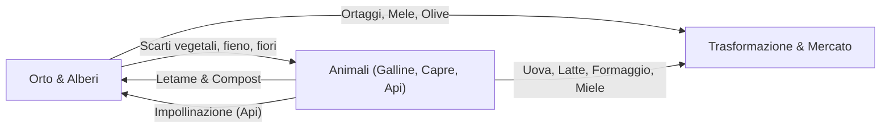

# Analisi di Progetto: Simulatore di Orto e Fattoria Reale (2D Pixel Art – Android Verticale)

> [!TIP]
> **Direzione confermata:** Un gioco **2D top-down in stile *Stardew Valley*** progettato nativamente in **verticale per Android**, senza veicoli da guidare, interamente dedicato alla **simulazione fedele del lavoro del contadino**: attrezzi manuali, orto, alberi da frutto (meleti, ulivi), allevamento e stagioni realistiche.

Togliere i veicoli 3D è una scelta vincente: riduce drasticamente la complessità tecnica e permette di investire tutta la profondità nella **simulazione botanica, nel ciclo della terra e nella sensazione tattile di curare la propria fattoria**.

---

## 1. Pilastro del Gameplay: Realismo Agronomico Accessibile

L'obiettivo è simulare un vero contadino senza trasformare il gioco in un foglio Excel: le regole devono essere **reali, leggibili visivamente e gratificanti**.

### Stagioni e Coltivazione Fuori Stagione (Libertà + Conseguenze)
A differenza di *Stardew Valley* (dove i semi fuori stagione non si possono piantare o spariscono istantaneamente il giorno 1 del mese successivo), qui il sistema funziona come nella realtà:
- **Libertà totale di semina:** Il giocatore può piantare qualsiasi seme in qualsiasi periodo dell'anno.
- **Simulazione di Temperatura e Luce:** Ogni giornata ha una temperatura minima/massima coerente con la stagione e il meteo (es. gelate invernali, ondate di calore estive).
- **Curve di risposta per ogni pianta:**
  - *Fascia Ottimale:* Crescita regolare, resa piena e qualità alta.
  - *Fascia Sub-ottimale (es. semina troppo precoce o tardiva):* Crescita lenta, pianta stressata, resa ridotta (pochi frutti o di qualità inferiore).
  - *Fascia Critica (es. pomodori d'inverno senza protezione):* Il seme non germina o la piantina subisce danni da gelo fino a seccare.
- **Tecniche reali per "battere" la stagione (Progressione):**
  - **Semenzaio al coperto** a fine inverno per anticipare le piantine estive.
  - **Teli protettivi / Tunnel bassi** per proteggere l'orto dalle gelate primaverili.
  - **Serra fredda** (obiettivo mid/late game) per coltivare fuori stagione in modo realistico.

### Il Suolo è Vivo (Terra, Acqua e Nutrienti)
Ogni singola zolla dell'orto conserva uno stato realistico:
- **Lavorazione:** Terreno incolto → Vangato (zolle grosse) → Rastrellato (letto di semina pronto).
- **Umidità:** Secco, Umido (ideale), Troppo bagnato (rischio marciume se si esagera o piove per giorni).
- **Fertilità e Rotazione:** Coltivare sempre la stessa pianta sullo stesso appezzamento impoverisce il terreno; alternare colture (es. legumi che arricchiscono la terra) o spargere **compost/letame** rigenera la fertilità.
- **Erbacce e Pacciamatura:** Le infestanti rubano acqua e nutrienti; si rimuovono con la zappa o si prevengono con paglia/pacciamatura.

---

## 2. Attrezzi del Contadino, Orto, Alberi e Animali

### Attrezzi Manuali Autentici
Ogni attrezzo ha uno scopo preciso e una progressione qualitativa (es. Ferro → Acciaio forgiato, che consuma meno fatica e lavora meglio):
- **Vanga:** Dissoda il terreno compatto e prepara nuove aiuole.
- **Zappa:** Rimuove erbacce, rompe la crosta superficiale e rincalza (es. patate).
- **Rastrello:** Livella il terreno vangato prima della semina e raccoglie foglie/fieno.
- **Annaffiatoio** (poi **tubi / irrigazione a goccia** per orti grandi).
- **Forbici da potatura / Cesoie:** Fondamentali per alberi da frutto, ulivi e sfemminellatura dei pomodori.
- **Falce / Falcetto:** Taglio di erba alta, grano, foraggio per gli animali.
- **Cassetta / Cestino di raccolta:** Per raccogliere ortaggi e frutta senza rovinarli.
- **Rimedi naturali (Spruzzatore):** Macerato d'ortica, rame/zolfo per trattare funghi o afidi quando piove molto.

### Tipologie di Colture dell'Orto (Esempi)
- **Radici e Tuberi (raccolta unica):** Patate, carote, cipolle, aglio (si pianta in autunno e si raccoglie in estate!), ravanelli.
- **Ortaggi da foglia (freschi/invernali):** Lattuga, spinaci, cavoli, verze, bietole (resistono al freddo!).
- **Ortaggi da frutto estivi (raccolta scalare):** Pomodori (richiedono tutori/canne), zucchine, peperoni, melanzane, cetrioli.
- **Legumi (rigenerano il suolo):** Piselli (primavera), fagioli e fagiolini (estate), fave (autunno/inverno).
- **Aromatiche perenni:** Rosmarino, salvia, basilico, timo.

### Arboricoltura: Meleti, Ulivi e Alberi da Frutto
Un sistema profondo che differenzia moltissimo il gioco dai farming sim arcade:
- **Crescita pluriennale:** Si pianta l'astone/piantina → cresce per 1–2 anni → entra in produzione.
- **Meleti, Peri, Ciliegi, Peschi, Fichi, Agrumi:**
  - **Inverno:** Riposo vegetativo + **potatura invernale** (se poti bene, producono frutta più grande e sana; se trascuri la potatura, la resa cala).
  - **Primavera:** Fioritura (esposta a gelate tardive; potenziata dalla presenza di api!).
  - **Estate/Autunno:** Maturazione e raccolta.
- **Ulivi:**
  - Molto rustici e resistenti alla siccità, temono solo i geli estremi prolungati.
  - Raccolta in **autunno** stendendo le reti sotto la chioma e raccogliendo le olive (manualmente o con pettine/abbacchiatore).
  - Trasformazione al **frantoio** per ottenere **Olio Extravergine** ad alto valore.

### Allevamento Circolare (Fattoria Integrata)
Gli animali non sono separati dall'orto, ma chiudono il cerchio ecologico della fattoria:

- **Galline:** Razzzolano, mangiano granaglie e scarti dell'orto, producono **uova** e **pollina** (ottimo concime, da compostare prima dell'uso).
- **Capre / Pecore:** Pascolano d'estate, mangiano fieno d'inverno; danno **latte** (per fare formaggi) e letame per i campi.
- **Arnie (Api):** Producono miele stagionale (millefiori, melo, acacia) e **aumentano la resa dei meleti e degli ortaggi** nel raggio circostante.

---

## 3. Ergonomia 2D in Verticale (Android One-Handed)

Su uno schermo verticale 2D in pixel art, i controlli devono essere **rilassanti e precisi**, senza dita che coprono la pianta su cui stai lavorando:

- **Controllo Ibrido (Tap + Joystick opzionale):**
  - **Tap-to-Act (Consigliato come default):** Tocchi una zolla o un albero → il contadino ci cammina vicino ed esegue l'azione. Perfetto con una mano sola.
  - **Drag per azioni continue:** Trascini il dito su una fila di 6 zolle per annaffiarle o seminarle tutte in sequenza fluida (soddisfazione tattile altissima!).
  - **Joystick flottante** attivabile dalle impostazioni per chi ama guidare il personaggio liberamente.
- **Smart Tooling (Attrezzo Contestuale):**
  - Se selezioni la modalità "Automatica", toccare terra incolta usa la vanga, terra asciutta usa l'annaffiatoio, frutta matura la raccoglie — riducendo del 70% i cambi manuali in inventario.
  - La **barra inferiore (zona pollice)** permette comunque di selezionare manualmente semi specifici, cesoie da potatura o trattamenti.
- **Almanacco del Contadino (UI chiave):**
  - Un tasto sempre raggiungibile apre il taccuino illustrato con: calendario delle semine, temperature tollerate da ogni pianta, sintomi di carenze/malattie e diario delle stagioni passate.

---

## 4. Scelte Tecniche Consigliate (2D Pixel Art su Android)

### Motore di Gioco: **Godot 4** (Scelta Consigliata)
Per un gioco 2D pixel art con simulazione a griglia su Android, **Godot 4** è ideale:
- **Leggerissimo e gratuito:** Nessuna royalty, export Android (AAB/APK) rapido, peso finale facilmente sotto i **50–80 MB**.
- **TileMapLayer nativo:** Perfetto per gestire strati multipli (terreno base, zolla vangata, umidità, pacciamatura, pianta, ombra, neve/pioggia).
- **Pixel Art nitida:** Gestione nativa del pixel snapping e scaling su diverse risoluzioni verticali Android (16:9, 19.5:9, 20:9).

### Architettura Dati della Simulazione (Data-Driven)
Separare la logica dai dati fin dal giorno 1 ti permetterà di aggiungere decine di semi, alberi e animali senza riscrivere codice:
- **Stato di ogni Cella (`TileData`):** `soil_state` (incolto/vangato/rastrellato), `moisture` (0–100), `fertility` (0–100), `weed_level`, `mulched` (bool), `crop_instance` (riferimento alla pianta).
- **Database Colture (JSON o Godot `Resource`):** Per ogni seme definisci:
  - `min_temp`, `optimal_temp_range`, `max_temp`
  - `days_to_grow`, `water_consumption`, `nutrient_consumption`
  - `is_perennial` / `multi_harvest`
  - `sprite_stages` (seme, germoglio, crescita, fioritura, maturo, stressato/gelato)
- **Simulazione Giornaliera / Oraria:** Al passaggio del tempo (e anche al cambio giorno), il sistema aggiorna temperatura, evaporazione dell'acqua, crescita proporzionale alla fascia termica e stato degli animali.

---

## 5. Rischi Specifici e Come Evitarli

> [!WARNING]
> **Rischio: Troppa complessità all'inizio (Overwhelming).**
> Se al Giorno 1 il giocatore deve gestire pH del suolo, 40 semi, 10 attrezzi, potature e malattie, abbandonerà il gioco in 5 minuti.

**Soluzione — Introduzione Graduale (Onboarding Naturale):**
- **Settimana 1:** Solo piccolo orto base, 3 semi di stagione, vanga, annaffiatoio e raccolta.
- **Mese 1:** Introduzione del meteo/temperature, erbacce e primo acquisto di un albero da frutto (es. un melo o un ulivo).
- **Stagione 2+:** Pollaio/compost, potature, nuovi semi, protezione dal freddo (teli/serra) e trasformazioni (olio, conserve).

---

## 6. Roadmap Consigliata per il Prototipo (MVP)

1. **Step 1 – Il Motore dell'Orto (2–3 settimane):**
   - Mappa 2D verticale 15×20 tile.
   - 4 attrezzi: Vanga, Rastrello, Annaffiatoio, Zappa.
   - 3 colture di test con esigenze opposte: **Lattuga** (primavera/fresco), **Pomodoro** (estate/caldo), **Cavolo** (inverno/freddo).
   - Sistema di temperatura giornaliera + verifica visiva di crescita normale vs fuori stagione.
2. **Step 2 – Alberi e Ciclo Annuale (3–4 settimane):**
   - Aggiunta di **Melo** e **Ulivo** (crescita, potatura invernale, fioritura, raccolta).
   - Cambio grafico delle 4 stagioni (colori dell'erba, foglie, neve/pioggia).
   - **Almanacco del Contadino** + vendita al mercatino.
3. **Step 3 – Animali e Circolarità (1–2 mesi):**
   - Pollaio con galline (uova + compost per fertilizzare l'orto) e Arnie (miele + bonus impollinazione).
   - Salvataggio automatico istantaneo e ottimizzazione touch su telefono Android reale.
