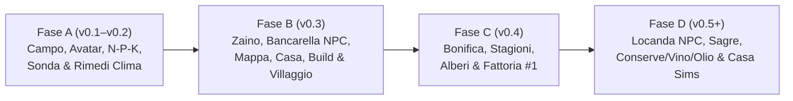

# Piano di Sviluppo a Micro-Milestone (Versioni Piccole & Testabili)

Invece di maxi-aggiornamenti rigidi, costruiamo **Ortobio** per **piccole micro-milestone mirate** (1–2 meccaniche alla volta). Ogni versione è subito giocabile in Godot 4, così possiamo testare ogni idea dal vivo e correggere liberamente design, bilanciamento o stile grafico prima di passare alla successiva.

---

## Fase A — Il Cuore Agronomico sul Campo

### `v0.1` — Prototipo Campo & Contadino *(Completata ✅)*
- Campo verticale parametrico `10×30`, blocchi autotiled arrotondati 3D stile *Stardew Valley*, 3 colture opposte (`Ravanello`, `Pomodoro`, `Cavolo Verza`), clima senza stress mortale da caldo.
- Contadino dettagliato `24×28` px con coda azioni e animazioni per strumento che partono all'arrivo sulla zolla.

### `v0.2a` — Suolo Vivo (`N-P-K`), Produttività & Sonda Analisi Suolo *(Prossima)*
- Simulazione `N / P / K` lenta e graduale su ogni zolla (3–5 raccolti prima di un calo visibile; nascosti di default finché non analizzi la zolla).
- **Produttività reale in pezzi** (terra ricca = più ortaggi raccolti; terra povera = meno pezzi, mai morte).
- Nuovo seme Legume (**Piselli**, rigenera `N`), primo **Concime Verde** (*Trifoglio*, interrabile con la Vanga per ricaricare `N-P-K`) e **Compost**.
- Strumento **Sonda Analisi Suolo `Lv. 1`** (animazione del contadino + rivelazione barre `N/P/K` nell'Ispettore e vista cromatica sulle zolle analizzate).

### `v0.2b` — Rimedi al Clima ("Problema → Rimedio") & Concimi Mirati
- Modalità `Costruisci` sul Campo (`1×1`): **Telo TNT** e **Campana di Vetro** (proteggono dal gelo i Pomodori e piante sensibili) + **Irrigatore base (`3×3`)**.
- **Concimi semplici per `N-P-K`**: *Concime Foglie (`N`)*, *Concime Radici (`P`)*, *Concime Frutti / Cenere (`K`)*.

---

## Fase B — Il Primo Gioco Completo (Mercato, Bancarella, Casa & Build)

### `v0.3a` — Zaino (con Freschezza), Bancarella al Mercato & Domanda/Offerta
- **Zaino / Magazzino** pulito (Semi, Raccolti con **Freschezza/Scadenza** → Scarti per Compost, Concimi, Materiali; attrezzi sempre pronti nella barra `Lavora`).
- **La Tua Bancarella al Mercato:** postazione fisica con **Cassette di Legno** potenziabili (Banco `Lv. 1→4`: da 3 fino a 9 cassette; Cassette `Lv. 1→4`: da 6 fino a 20 prodotti) + **clienti NPC del villaggio** che passano e comprano secondo **Domanda & Offerta del giorno**.
- Acquisto semi, vendita d'emergenza all'ingrosso (`80%`) e rete **anti-soft-lock**.

### `v0.3b` — Mappa Generale, Casa Base, Riepilogo Serale & Salvataggio
- **Mappa Generale** in mini-pixel art (Casa, Campo #1, Villaggio/Mercato).
- **Casa base** con il nostro contadino, il **Letto** (schermata **Riepilogo Giornaliero** con incassi bancarella, XP e crescita notturna) e il **Barometro** (previsione meteo di domani).
- **Salvataggio automatico locale** (`SaveManager`).

### `v0.3c` — Build del Contadino (Punti Abilità) & Villaggio `Lv. 1 → Lv. 2`
- **XP & Punti Abilità** spendibili a scelta nelle **6 caratteristiche** (*Agilità* movimento, *Destrezza* velocità azione, *Resistenza* energia, *Agronomia* produttività, *Selezione Semi*, *Commercio & Fattoria*) con **Talenti Speciali a Lv. 5**.
- **Livello Villaggio (`Lv. 1 → Lv. 2`):** investimento in monete che apre **Bottega Agronomo** (Sonda, Telo TNT, concimi), **Fabbro Ferro**, **Falegname** e amplia la capacità del mercato (`+20%` domanda).

### `v0.3d` — Bacheca Ordini, Eventi Randomici & Almanacco v1
- **Bacheca Ordini settimanali** (zero penalità se scadono; ricompense variegate: `€`, XP, Compost, semi).
- Primi **Eventi Randomici** (es. *Carovana dei Mercanti*, *Serata in Osteria*, *Rugiada Rigenerante*, *Settimana a Tema*).
- **Almanacco v1** (schede colture, meteo oggi/domani, registro collezione).

---

## Fase C — Espansione Agricola, Stagioni & Fattoria

### `v0.4a` — Bonifica del Campo, Piante Compagne & Polish Visivo/UI (Stagioni, Atmosfera, Menu)
- Bonifica progressiva delle fasce incolte del campo (erba alta, rami, pietre → **Legna, Pietra, Fibre**).
- Espansione catalogo a **10–12 colture** (incluse 1–2 **Piante Compagne** leggere e facoltative).
- **Polish Atmosfera & Stagioni:** stagioni più riconoscibili visivamente (fiori primaverili, foglie cadenti in autunno, neve/brina in inverno), **animazioni del vento** sulle piante, **ombre delle nuvole** che scorrono sul campo e **ombre orientate dal sole** che cambiano dall'alba al tramonto per percepire lo scorrere del tempo.
- **Restyling Menu Inferiore (`ToolDock`):** interfaccia più curata visivamente e più comoda col pollice (es. tab/categorie pulite Attrezzi / Semi / Concimi / Costruisci).

### `v0.4b` — Arboricoltura (Melo & Ulivo) & Traguardi della Valle (Bundle)
- Primi alberi `2×2` (**Melo**, **Ulivo**) con potatura invernale, fioritura e raccolta.
- **Traguardi della Valle** (cassette permanenti che sbloccano grandi agevolazioni).

### `v0.4c` — Fattoria #1, Recinti & Pollaio (Circolarità)
- Sblocco **Fattoria #1** sulla Mappa Generale: disegno staccionate + calcolo area interna (**flood-fill**), **Pollaio + Galline**, **Compostiera** (scarti + pollina → Compost!).
- **Banco Fresco** sulla Bancarella per vendere Uova/Latticini.

---

## Fase D — Mid/Late-Game: Borgo Vivo, NPC, Raffinazione & Casa Stile *The Sims*

### `v0.5a` — Villaggio `Lv. 3`, Locanda (1° NPC) & Sagra di Fine Stagione
- **Locanda del Borgo** (reclutamento **1° NPC** in Mid-Game: *Bracciante Orto* oppure *Fattore*, con crescita esperienza nel tempo), **Mercante Ambulante** (semi rari/varietà antiche), **Campo #2**.
- **Sagra / Fiera di Fine Stagione (Giorno 28)** con premio permanente **"Marchio del Borgo"** (`+10% / +20%` valore e richiesta del prodotto vincitore) e trofei per la Casa.

### `v0.5b` — Raffinazione (Conserve, Olio EVO, Vino, Formaggi) & Villaggio `Lv. 4–5`
- **Frantoio, Cantina & Conserve:** prodotti trasformati **senza scadenza** ad alto valore + **Scaffale Vasetti** e **Rastrelliera Bottiglie** (e predisposizione **Banco Specialità**) sulla Bancarella.
- **Vigna a filari**, **Api**, **Capre, Maiali, Mucche**, **Sonda `Lv. 2` (`3×3`)**, **NPC Artigiano & Venditore Bancarella**.

### `v0.5c` — Casa Stile *The Sims* Multi-Piano/Sotterranei, Serra Fredda & Polish Android
- Editor a blocchi della Casa (stanze, mobili, piani `+1/+2`) e **Sotterranei (`-1` Cantina Vini/Olio, `-2` Conservazione fresca che prolunga la durata dei raccolti)**.
- **Serra Fredda**, **Tunnel Basso**, **Irrigazione a Goccia**, polish audio/UI Android e preparazione pubblicazione Google Play.

---

## Architettura Tecnica (Godot 4)
- `data/` → JSON parametrici (`balance_config.json`, `crops.json`, `village_levels.json`, `market_config.json`, ecc.).
- `core/` → Simulazione pura disaccoppiata dalla grafica (`TimeWeatherManager`, `GridSimulation`, `InventoryManager`, `MarketStallManager`, `FarmerProgressManager`, `VillageManager`, `SaveManager`).
- `scenes/` & `ui/` → Schermate singole (`WorldMap`, `FieldScreen`, `FarmScreen`, `MarketScreen`, `HouseScreen`) e componenti modulari (`TopBar`, `ToolDock`, `TileInspector`, `VerticalMinimap`, `AlmanacSheet`).
