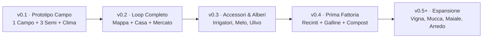

# Piano di Sviluppo Incrementale (Partire Piccoli, Crescere Bene)

Per evitare di restare bloccati dalla mole di contenuti, costruiamo il gioco a **strati indipendenti**: ogni versione è già giocabile e testabile su telefono Android, permettendoci di calibrare **dimensione dei blocchi, scroll, tempi e bilanciamento** prima di aggiungere il pezzo successivo.

---

## Le 5 Milestone Incrementali

### Milestone 1 (`v0.1`) — Il Cuore dell'Orto *(Obiettivo: 1–2 settimane)*
**Solo ciò che serve per capire se giocare in verticale è piacevole e qual è la dimensione ideale dei blocchi.**
- **1 solo Campo** con griglia parametrica (es. partiamo da `10×25` o `10×40` per testare lo scroll e il touch su telefono).
- **4 attrezzi:** Vanga, Rastrello, Annaffiatoio, Raccogli/Esplora.
- **3 semi opposti** (da `crops.json`):
  1. **Ravanello** (veloce, 4 gg, primavera).
  2. **Pomodoro** (estivo, raccolta scalare, soffre il freddo).
  3. **Cavolo Verza** (invernale, resiste al gelo).
- **Motore Clima & Giorni:** Tasto "Dormi / Giorno Successivo" temporaneo + visualizzazione Temperatura, Stagione e crescita (inclusa la prova del fuori stagione!).
- *Cosa verifichiamo in questa fase:* Grandezza dei tile sul telefono, comodità tra `Esplora` (scroll) e `Lavora` (drag), leggibilità dello stato della terra e delle piante.

### Milestone 2 (`v0.2`) — Il Primo Gioco Completo
- **Mappa Generale (Mini Pixel Art):** Schermata hub con 3 punti cliccabili (Casa, Campo #1, Mercato).
- **Casa base:** Qui si trova il Letto per dormire e passare al giorno successivo.
- **Mercato base:** Compri i semi e vendi i raccolti (prima economia funzionante).
- **Salvataggio locale automatico** (JSON/file binario sul telefono) + **Almanacco v1** (solo scheda dei semi presenti e meteo).

### Milestone 3 (`v0.3`) — Profondità Agricola & Arboricoltura
- **Accessori da Campo (1×1):** Spaventapasseri, Irrigatore base, Telo TNT (per testare gli ingombri e i raggi d'azione).
- **Primi 2 Alberi:** **Melo** e **Ulivo** (per testare l'ingombro `2×2` o `3×3` sulla griglia e la potatura invernale).
- Espansione graduale del catalogo semi (da 3 a 10–12 colture) e introduzione erbacce/zappa.

### Milestone 4 (`v0.4`) — La Fattoria e i Recinti
- Sblocco sulla Mappa Generale della **Fattoria #1**.
- **Sistema Recinti:** Disegno staccionate + calcolo automatico area interna + **Pollaio** + **Galline** + **Abbeveratoio/Mangiatoia**.
- **Compostiera:** Collega Fattoria e Campo (letame → concime per l'orto).

### Milestone 5 (`v0.5+`) — Contenuti Avanzati & Rifinitura
- **Vigna** (filari + cantina), **Frantoio** (olio), **Api**, **Capre**, **Maiali**, **Mucche** e giochi per animali.
- **Arredamento della Casa** (mobili comprabili al mercato).
- **Nuovi Campi** acquistabili sulla Mappa Generale + ottimizzazione grafica, audio rilassante e polish Android.

---

## Architettura Tecnica Leggera (Consigliata: Godot 4)

Per mantenere tutto pulito e facilmente modificabile durante i test di bilanciamento:

- **Struttura Cartelle Pulita:**
  - `data/` → File JSON/Resource facilmente modificabili (`crops.json`, `accessories.json`, `animals.json`, `balance_config.json` con `grid_width`, `grid_height`, dimensioni blocchi).
  - `core/` → Logica pura separata dalla grafica (`TimeWeatherManager`, `GridSimulation`, `EnclosureCalculator`, `EconomyManager`, `SaveManager`).
  - `scenes/` → Le schermate singole (`WorldMap.tscn`, `FieldScreen.tscn`, `FarmScreen.tscn`, `HouseScreen.tscn`, `MarketScreen.tscn`).
  - `ui/` → Componenti riutilizzabili (`TopBar`, `ToolDock`, `TileInspector`, `AlmanacSheet`).
- **Perché separare `core/` da `scenes/`:** Puoi cambiare la grandezza della griglia, la grafica pixel art o gli ingombri di alberi e accessori in 30 secondi senza mai rompere la simulazione agronomica o i salvataggi.
