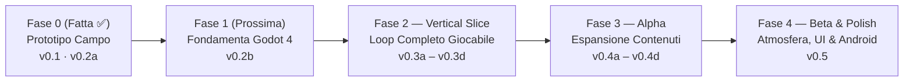

# Piano di Sviluppo Professionale — Ortobio (Fondamenta → Vertical Slice → Espansione → Polish)

Seguendo le best practice di produzione indie per farming sim in **Godot 4**, dividiamo lo sviluppo in **4 fasi strutturate a micro-milestone**: prima costruiamo **le fondamenta architetturali** (`GameState`, `SaveManager`, `SceneManager`, `InventoryManager`), poi completiamo un **Vertical Slice giocabile** con tutto il loop chiuso, e solo dopo **scaliamo i contenuti** senza mai dover riscrivere codice.

---

## Fase 0 — Prototipo Campo & Agronomia Base *(Completata ✅)*

- **`v0.1` ✅:** Griglia verticale `10×30`, autotiling arrotondato 3D stile *Stardew Valley*, 3 semi opposti, clima senza stress mortale da caldo, contadino dettagliato `24×28` con coda azioni e animazioni per strumento all'arrivo.
- **`v0.2a` ✅:** Simulazione `N-P-K` lenta e nascosta di default, produttività reale in pezzi, **Piselli**, **Trifoglio** (concime verde interrabile con la Vanga), **Compost**, **Sonda Analisi Suolo**, vista cromatica `N-P-K` e stile visivo della terra concimata.

---

## Fase 1 — Fondamenta Architetturali *(Priorità Immediata)*

### `v0.2b` — Scheletro Professionale (`GameState`, `SaveManager`, `SceneManager`, `InventoryManager`)
*Obiettivo: spostare tutti i dati fuori dalle singole scene prima di costruire Mercato, Casa e Mappa, così ogni meccanica futura nasce già persistente e multi-schermata.*
- **`GameState` (Autoload):** unico stato persistente del mondo (`TimeWeatherManager`, dizionario dei Campi `Campo #1` già predisposto per `#2/#3`, monete, progressione contadino, livello villaggio).
- **`InventoryManager` (in `GameState`):** Zaino/Magazzino data-driven per **Semi**, **Raccolti con Freschezza/Scadenza** (se scadono diventano *Scarti Vegetali*), **Concimi**, **Accessori** e **Materiali** (gli attrezzi restano sempre pronti nella barra `Lavora`).
- **`SaveManager` (Autoload):** pattern `to_dict()` / `from_dict()` per salvare e ricaricare su JSON locale (`user://savegame.json`) l'intero stato del gioco, **testato con unit test automatici prima di aggiungere nuovi contenuti**.
- **`SceneManager` (Autoload):** cambio schermata fluido con **Pausa Intelligente** centralizzata (`Campo` ↔ `Mappa` ↔ `Casa` ↔ `Mercato`).

---

## Fase 2 — Vertical Slice Giocabile *(Tutto il Loop Chiuso in Miniatura)*

*Riduciamo l'ampiezza (5 colture, 1 campo, 1 villaggio Lv. 1→2), ma colleghiamo tutti i pilastri del gioco da inizio a fine.*

### `v0.3a` — Mappa Generale, Casa Base, Riepilogo Serale & Zaino Vivo
- **Mappa Generale** in mini-pixel art cliccabile (**Casa**, **Campo #1**, **Villaggio/Mercato**).
- **Casa base** con il nostro contadino, il **Letto** (schermata **Riepilogo Giornaliero** + salvataggio automatico) e il **Barometro** (previsione meteo di domani).
- Raccolti dal campo depositati nello **Zaino** con contatore **Freschezza**.

### `v0.3b` — La Tua Bancarella al Mercato + Domanda & Offerta + Clienti NPC
- **Postazione fisica al Mercato** con **Cassette di Legno** potenziabili (Banco `Lv. 1→4`: da 3 a 9 cassette; Cassette `Lv. 1→4`: da 6 a 20 prodotti).
- **Clienti NPC del villaggio** che passano e comprano secondo **Domanda & Offerta del giorno**, acquisto semi, vendita d'emergenza all'ingrosso (`80%`) e rete **anti-soft-lock**.

### `v0.3c` — Rimedi Clima (`Costruisci` `1×1`) & Concimi Mirati `N / P / K`
- Modalità `Costruisci` sul Campo (già salvata da `SaveManager`): **Telo TNT**, **Campana di Vetro** (protezione gelo + velocità) e **Irrigatore Base (`3×3`)**.
- **Concimi semplici per `N-P-K`** (*Concime Foglie `N`*, *Concime Radici `P`*, *Concime Frutti / Cenere `K`*).

### `v0.3d` — Build del Contadino, Villaggio `Lv. 1 → Lv. 2`, Bacheca Ordini & Almanacco v1
- **XP & Punti Abilità** spendibili nelle **6 caratteristiche** (*Agilità*, *Destrezza*, *Resistenza*, *Agronomia*, *Selezione Semi*, *Commercio & Fattoria*) con **Talenti Lv. 5**.
- **Villaggio `Lv. 1 → Lv. 2`** (investimento in monete che apre **Bottega Agronomo** per Sonda/Telo TNT, **Fabbro Ferro**, **Falegname** e amplia la domanda del mercato; `0 NPC` fino al Lv. 3).
- **Bacheca Ordini settimanali** (zero penalità se scadono) e **Almanacco v1** (schede colture, meteo oggi/domani, collezione).

---

## Fase 3 — Alpha / Espansione Contenuti *(Scalare sul Motore Solido)*

### `v0.4a` — Bonifica Campo, 10–12 Colture (Piante Compagne) & Alberi (`Melo`, `Ulivo`)
- Bonifica progressiva (erba alta, rami, pietre → **Legna, Pietra, Fibre**).
- Espansione catalogo semi (incluse **Piante Compagne** leggere e facoltative) + primi alberi `2×2` (**Melo**, **Ulivo**) con potatura invernale e raccolta.

### `v0.4b` — Fattoria #1, Recinti Flood-Fill, Pollaio & Compostiera
- Sblocco **Fattoria #1** sulla Mappa: staccionate + calcolo area interna (**flood-fill**), **Pollaio + Galline**, **Compostiera** (Scarti + Pollina → Compost) e **Banco Fresco** in Bancarella.

### `v0.4c` — Mid-Game: Villaggio `Lv. 3`, Locanda (1° NPC), Eventi, Traguardi & Sagre
- **Locanda del Borgo** (reclutamento **1° NPC**: *Bracciante* o *Fattore* che cresce con l'esperienza), **Mercante Ambulante** (semi rari/varietà antiche), **Campo #2**.
- **Eventi Randomici** (*Carovana dei Mercanti*, *Rugiada Rigenerante*, *Settimana a Tema*), **Traguardi della Valle (Bundle)** e **Sagra di Fine Stagione (G.28)** con premio permanente **"Marchio del Borgo"**.

### `v0.4d` — Late-Game: Raffinazione, Villaggio `Lv. 4–5`, Casa *The Sims* & Serra
- **Frantoio, Cantina & Conserve** (prodotti senza scadenza ad alto valore) + **Scaffale Vasetti**, **Rastrelliera Bottiglie** e **Banco Specialità** in Bancarella + **Vigna**, **Api**, **Capre/Maiali/Mucche** + **Sonda `Lv. 2` (`3×3`)** + **NPC Artigiano & Venditore**.
- **Casa a blocchi stile *The Sims*** multi-piano (`+1/+2`) e **Sotterranei (`-1` Cantina, `-2` Conservazione fresca)** + **Serra Fredda**, **Tunnel Basso**, **Irrigazione a Goccia**.

---

## Fase 4 — Beta, Polish Visivo/UI & Lancio Android (`v0.5`)

- **Restyling Menu Inferiore (`ToolDock`):** interfaccia curata in pixel art / legno caldo e più comoda col pollice (categorie pulite Attrezzi / Semi / Concimi / Costruisci).
- **Atmosfera Viva & Stagioni:** animazione del **vento** sulle piante, **ombre delle nuvole** che scorrono sul campo, **ombre dinamiche orientate dal sole** dall'alba al tramonto, e dettagli stagionali ricchi (fiori, foglie che cadono, neve/brina).
- **Bilanciamento & Release Android:** test simulato dell'economia su più anni, audio ambientale/musica leggera, ottimizzazione touch su telefono reale ed export **APK/AAB Google Play**.
