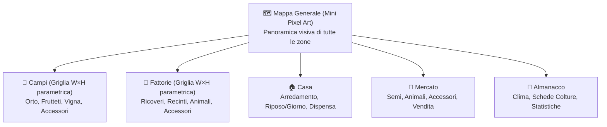

# Progettazione UI/UX & Architettura a Schermate (Griglia 10×90 Verticale)

> [!TIP]
> **Perché questa scelta è eccellente per Android:** Una griglia fissa da **10 blocchi in larghezza × 90 in altezza** si sposa alla perfezione con gli schermi verticali. Le 10 colonne riempiono esattamente la larghezza del telefono (ogni blocco è grande e facile da toccare), mentre si scorre naturalmente **solo in verticale** come un'app nativa. Eliminare la camminata manuale del personaggio rende il gioco immediato, rilassante e molto più pulito da sviluppare.

---

## 1. Architettura a Schermate Singole & Mappa Generale

Il punto di raccordo del gioco è la **Mappa Generale della Valle**, disegnata in una **pixel art più compatta (mini-pixel)** ma immediatamente riconoscibile: vedi la tua casetta, il tuo orto (con i colori della stagione attuale), i campi ancora incolti/acquistabili, le aree fattoria e il mercatino del paese.

Toccare una zona sulla Mappa Generale apre direttamente la sua **schermata dedicata**:



> [!NOTE]
> **Dimensioni Parametriche (da tarare giocando):** Sia la dimensione della griglia (es. `10×30`, `10×60`, `10×90`) sia l'ingombro in blocchi di alberi, accessori e ricoveri (`1×1`, `2×2`, `3×2`) vanno tenuti **configurabili da file dati**. Il bilanciamento definitivo si decide provando direttamente il prototipo sul telefono.

- **Più Campi / Più Fattorie (Progressione):** Si parte con **1 Campo** (magari con solo i primi `10×20` blocchi sbloccati/ripuliti all'inizio, espandibili fino a `10×90`!) e **1 Fattoria** da sbloccare più avanti. Nel late-game il giocatore può acquistare un secondo Campo (es. uno solo per Uliveto/Vigna e uno solo per l'Orto).

---

## 2. Wireframe della Schermata "Campo" e "Fattoria" (`10 × 90`)

```text
┌────────────────────────────────────┐
│ [Prim. G.12] [☀️ 19°C]  [🪙 420]   │ ← TOP BAR (8–10%)
│ [Campo #1 ▼]            [⚡ 85/100]│   Switch rapido Campo/Fattoria
├──────────────────────────────────┬─┤
│ 🌳🌳 · 🌳🌳 · 🍇🍇🍇 · ·         │▲│
│ 🌳🌳 · 🌳🌳 · 🍇🍇🍇 · ·         │░│
│  ·  ·   ·  ·   ·  ·  · ·         │█│ ← MINIMAPPA / SCROLLBAR
│ 🟫🟫🟫🟫 💧 🟫🟫🟫🟫 ·           │░│   VERTICALE (Bordo destro:
│ 🍅🍅🍅🍅 💦 🍅🍅🍅🍅 🪤           │░│   salti subito tra Orto,
│ 🟫🟫🟫🟫 💧 🟫🟫🟫🟫 ·           │░│   Vigna e Frutteto!)
│  ·  ·  🐦‍⬛  ·   ·  ·  · ·         │░│
│ 🟩🟩🟩🟩🟩🟩🟩🟩 · ·             │░│
│ 🌱🌱🌱🌱🌱🌱🌱🌱 · ·             │░│
│  ·  ·   ·  ·   ·  ·  · ·         │▼│
├──────────────────────────────────┴─┤
│ [✋ Esplora] [🛠️ Lavora] [🏗️ Costruisci] │ ← MODALITÀ (Zona Pollice)
│ [🪓][🪴][💧][✂️][🌱][🪤] │ [🎒]     │ ← BARRA ATTREZZI / OGGETTI
├────────────────────────────────────┤
│ [🌱 Campi] [🐄 Fattoria] [🏠 Casa] [🏪 Mercato] [📖] │ ← NAVIGAZIONE
└────────────────────────────────────┘
```

### Risoluzione & Dimensione Blocchi (`10` Colonne Fisse)
- Con **10 blocchi in larghezza**, se usiamo tile da **`16×16` px** (o `24×24` px):
  - Larghezza logica della griglia: `160 px` (+ `12–16 px` per bordo/scrollbar verticale = **`176×320` o `180×360` px** logici).
  - Su uno smartphone moderno da `390–412 dp` di larghezza, **ogni singolo blocco misura ~38–40 dp**: abbastanza grande per essere premuto col pollice senza errori, mostrando circa **14–16 righe** alla volta sullo schermo (su 90 totali).

---

## 3. Interazione Diretta: Esplora vs Modalità Lavoro/Creazione

Poiché la griglia scorre in verticale per 90 righe, è fondamentale separare in modo cristallino **lo scorrimento** dal **lavoro sui blocchi**:

1. **✋ Modalità Esplora (Default):**
   - **Swipe 1 dito su/giù:** Scorre fluidamente lungo le 90 righe del Campo o della Fattoria.
   - **Tap singolo su un blocco:**
     - Se c'è un frutto maturo / uovo / latte pronto → **Raccoglie subito** con 1 tap!
     - Altrimenti apre un **micro-pannello in basso** con lo stato del blocco (coltura, % crescita, umidità, temperatura, salute).
2. **🛠️ Modalità Lavoro (Attrezzi & Semi):**
   - Selezioni un attrezzo (es. Vanga, Annaffiatoio, Cesoie) o un seme (es. Pomodoro).
   - **Tap o Drag 1 dito sui blocchi:** Evidenzia i blocchi toccati e applica subito l'azione (es. trascini su una fila di 8 blocchi per vangarli o seminarli tutti insieme!).
   - *Come scorrere mentre lavori?* Usi la **barra verticale laterale** col pollice oppure uno swipe a **2 dita**.
   - **Animazione:** Il personaggio contadino non deve camminare da capo a piedi della mappa: appare brevemente / si sposta con un piccolo effetto o animazione di zappata/semina direttamente sul blocco (o lascia un feedback particellare + suono + micro-vibrazione).
3. **🏗️ Modalità Costruzione (Accessori & Recinti):**
   - Permette di posizionare, spostare o rimuovere oggetti che occupano **1 o più blocchi** (es. Spaventapasseri `1×1`, Irrigatore `1×1` con raggio evidenziato in blu, Pollaio `3×2`, Recinzione disegnata col dito lungo il perimetro).

---

## 4. Campo (`10×90`): Colture e Accessori Agricoli

Nel Campo si possono mescolare liberamente orto, frutteti (`2×2` blocchi per albero), filari di vigna (`1×N`) e accessori tecnici.

| Accessorio da Campo | Ingombro | Funzione Realistica & Raggio d'Azione |
| :--- | :---: | :--- |
| **Spaventapasseri** | `1×1` | Protegge i semi appena piantati e la frutta dagli uccelli in un raggio `5×5` (mostrato in anteprima quando lo piazzi). |
| **Trappola per Talpe / Insetti** | `1×1` | Riduce drasticamente i danni da parassiti/roditori nel raggio `4×4` (da svuotare/ricaricare ogni tanto). |
| **Irrigatore / Goccia** | `1×1` o tubo | Annaffia automaticamente ogni mattina le zolle adiacenti (`3×3` base, `5×5` avanzato). |
| **Telo TNT / Tunnel** | `1×1` o `1×4` | Protegge i blocchi sottostanti dal gelo (`+4°C` / `+6°C`). |
| **Rete Ombreggiante** | `2×2` | Abbassa la temperatura estiva (`-5°C`) sui blocchi coperti. |
| **Compostiera** | `2×1` | Trasforma scarti vegetali/letame in sacchi di compost fertile. |
| **Arnia (Api)** | `1×1` | Produce miele e dà `+25%` resa a frutteti e ortaggi nel raggio `7×7`. |
| **Vialetti / Pietre** | `1×1` | Estetici + bloccano la crescita delle erbacce sui blocchi occupati. |

---

## 5. Fattoria (`10×90`): Ricoveri, Recinti e Accessori Animali

Nella schermata Fattoria il giocatore progetta veri e propri spazi per gli animali usando la stessa griglia `10×90`:

### Meccanica del Recinto (Spazio = Capacità & Benessere)
- Ogni specie richiede **1 Ricovero** (es. Pollaio, Stalla) collegato a un **Recinto chiuso** (con cancelletto) disegnato dal giocatore con le staccionate.
- Il gioco calcola automaticamente l'**area interna libera del recinto** (algoritmo flood-fill semplice su griglia `10×90`):
  - **Galline:** 1 animale ogni **3 blocchi** liberi (es. recinto `6×5` = 30 blocchi → fino a 10 galline).
  - **Capre / Maiali:** 1 animale ogni **6 blocchi** liberi.
  - **Mucche:** 1 animale ogni **10 blocchi** liberi.
- **Impatto sul realismo:** Se il recinto è ampio e ben attrezzato, gli animali hanno **Benessere Alto** (producono latte/uova di qualità Pregiata ⭐). Se è troppo piccolo, non puoi aggiungere altri animali finché non allarghi la recinzione.

### Accessori della Fattoria (Occupano Blocchi nel Recinto)

| Accessorio Animale | Ingombro | Funzione |
| :--- | :---: | :--- |
| **Ricovero (Pollaio / Porcile / Stalla)** | `3×2` fino a `4×3` | Riparo notturno/invernale obbligatorio; qui si raccolgono uova/latte. |
| **Recinzione & Cancelletto** | `1×1` per segmento | Delimita l'area del recinto (legno, pietra, rete). |
| **Abbeveratoio** | `1×1` o `2×1` | Mantiene idratati gli animali nel recinto (da riempire o collegare all'acqua). |
| **Mangiatoia / Rastrelliera Fieno** | `2×1` | Contiene mangime/fieno per più giorni (fondamentale in inverno). |
| **Giochi / Arricchimento** | `1×1` o `2×2` | Es. *Pozza di fango* (Maiali), *Tronco/Rampa* (Capre), *Spazzola rotante* (Mucche), *Bagno di sabbia* (Galline) → aumenta felicità e qualità prodotti! |
| **Albero da Ombra** | `2×2` | Protegge gli animali dal caldo estivo dentro il recinto. |

---

## 6. Le Altre Schermate Singole

- **🏠 Casa (Arredamento & Riposo):** Una stanza/casetta a griglia personalizzabile (mobili, tappeti, scaffali con vasetti delle tue conserve, trofei stagionali). Qui trovi il **Letto** (per passare al giorno successivo) e magari un piccolo **Semenzaio da finestra** per preparare le piantine prima della primavera!
- **🏪 Mercato:** Schermata pulita a tab per comprare semi, alberelli, animali, accessori/recinzioni, mobili per la casa e vendere il raccolto (o consegnare olive/uva a Frantoio e Cantina).
- **📖 Almanacco:** Sempre accessibile con 1 tap per controllare meteo, temperature dei semi e stato di tutti i campi/fattorie.

---

## 7. Verifica di Coerenza con il Punto 1 (Cosa si Semplicifica!)

Questa nuova architettura **si integra benissimo** con il Punto 1, con un solo piccolo aggiustamento vantaggioso da tenere a mente:
- Avendo **Campi** e **Fattorie** separati, le **Arnie (Api)** possono essere posizionate sia nel **Campo** (come accessorio agricolo per impollinare frutteti e orto!) sia nella **Fattoria** (come allevamento di miele).
- Il **Letame/Compost** prodotto nella Fattoria va semplicemente nello **Zaino / Magazzino condiviso**, così puoi usarlo subito quando ti sposti nella schermata Campo.
- All'inizio del gioco, per rispettare la progressione spalmata nelle ore di gioco, il Campo `10×90` può partire con i primi `10×15` blocchi puliti e gli altri `10×75` coperti da rovi/erba alta/pietre da bonificare man mano che cresci!
