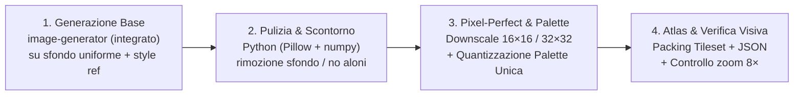

# Analisi: Stile Grafico, Assets & Audio (In Totale Autonomia)

L'obiettivo è avere un gioco **visivamente coerente, caldo e riconoscibile** (stile *Stardew Valley* mediterraneo) senza bloccarsi sulla produzione grafica o audio e garantendo la **piena sicurezza legale** per una pubblicazione su Google Play.

---

## 1. Direzione Artistica: "Pixel Art Cozy Mediterranea"

Per far sì che tutto sembri disegnato dalla stessa mano, fissiamo **3 regole rigide** fin dall'inizio:

1. **Griglia Pixel Unica (`16×16` px):** Ogni zolla, seme, ortaggio e icona usa la stessa densità di pixel (`16×16`; gli alberi `32×32` o `32×48`). La **Mappa Generale** usa una scala più compatta (mini-pixel), comunque sulla stessa palette.
2. **Palette Colori Fissa (24–32 colori):** Usiamo una sola palette calda e armoniosa (ispirata ai toni naturali: terracotta, verde oliva, ocra, azzurro cielo, legno caldo). **Ogni asset** — che sia generato, disegnato o importato — viene bloccato su questa palette.
3. **Niente 4× il lavoro per le stagioni (Trucco Shader):** Invece di disegnare 4 versioni di ogni prato e foglia, usiamo un **cambio palette / tint stagionale** automatico in codice:
   - *Primavera:* verdi freschi e fiori pastello.
   - *Estate:* verdi intensi, luce calda dorata.
   - *Autunno:* ocra, arancio, foglie calde.
   - *Inverno:* toni freddi, brina e neve.
   - **Ciclo Giorno/Notte:** Un semplice overlay di luce (`CanvasModulate`) gestisce alba, mezzogiorno, tramonto e sera senza dover ridisegnare nulla.

---

## 2. Risorse Gratuite vs Generazione Autonoma: Cosa Conviene?

Sì, esistono moltissime risorse **gratuite e legali anche per uso commerciale** (soprattutto con licenza **CC0 / Pubblico Dominio**, dove non serve nemmeno citare l'autore, o **CC-BY**, dove basta un nome nei crediti). Ecco un confronto onesto:

| Approccio | Punti di Forza | Limiti |
| :--- | :--- | :--- |
| **1. Pack Gratuiti (CC0 / Itch.io / Kenney)** Es. *Sprout Lands* (base), *Kenney.nl*, *OpenGameArt* | Qualità immediata, ottimi per UI, terreni e ortaggi classici. 100% legali (verificando sempre la licenza CC0/CC-BY). | Difficile trovare nello **stesso identico stile** elementi specifici come *ulivo con reti*, *vigna potata*, *telo TNT*, *pozza di fango per maiali*. Mescolare 4 pack diversi crea un "effetto collage". |
| **2. Generazione Autonoma (Fatta da me)** • **Sprite `16×16` pixel-perfect via script Python** • **Concept/Mappa via Image Generator + quantizzazione palette** • **SFX e loop audio via sintesi Python** | **Autonomia al 100%**, coerenza totale (stessa palette, stessa griglia `16×16`), zero vincoli di licenza, puoi aggiungere un nuovo ortaggio o accessorio in pochi minuti. | Le immagini generate con AI pura *non* sono pixel-perfect native: vanno sempre convertite/rifinite sulla griglia `16×16` e sulla palette fissa, oppure generate direttamente pixel-by-pixel via codice per i tile e le icone. |

> [!TIP]
> **Strategia Consigliata (Autonomia Totale + Opzione Upgrade):**
> - **Fase Prototipo & MVP (`v0.1` – `v0.3`):** Genero **tutto io in autonomia** (tileset `16×16` pixel-perfect in Python su palette fissa, icone attrezzi/semi, Mappa Generale in mini-pixel, effetti sonori `.wav/.ogg` e sottofondo rilassante). Zero attese, 100% coerenza, 100% tuoi.
> - **Fase Polish (se vorrai fare un salto estetico finale):** Potremo affinare gli sprite chiave (es. animali e alberi) uno per uno mantenendo esattamente lo stesso sistema di tile, oppure sostituire i file PNG del tileset con un pack CC0/custom senza toccare una riga di codice!

---

## 3. Piano Audio (Rilassante, Leggero, 100% Autonomo)

In un gioco cozy su telefono, l'audio fa metà dell'atmosfera — e va progettato pensando che molti giocano **a volume basso o senza audio** (quindi il feedback visivo + vibrazione aptica resta fondamentale).

### I 3 Strati Sonori
1. **Effetti Sonori Tattili (SFX) — Generabili in autonomia (`.wav`/`.ogg`):**
   - **Terra/Vanga:** suono corto, terroso e morbido (rumore filtrato passa-basso + piccolo colpo).
   - **Annaffiatoio:** breve scroscio d'acqua delicato.
   - **Semina / Raccolta:** "pop" legnoso/armonico gratificante (tono leggermente crescente quando raccogli 5 blocchi di fila in drag!).
   - **Cesoie (Potatura):** doppio "snip" metallico morbido.
   - **UI / Almanacco:** click morbidi tipo legno o pagina di carta che si gira.
2. **Atmosfera Ambientale (Ambience):**
   - Brevi loop leggerissimi di **brezza/uccellini** (giorno di sole), **pioggia morbida** (giorni piovosi), **grilli** (tramonto/sera), **vento invernale**.
3. **Musica Cozy (Opzionale / Leggera):**
   - Loop brevi e non invasivi (es. arpeggio morbido di chitarra/piano/carillon in stile *Stardew Valley* / lo-fi acustico), 1 tema breve per stagione, oppure tracce gratuite CC0 da *OpenGameArt / Pixabay* (verificate una per una).

---

## 4. Pipeline & Strumenti Migliori per la Generazione Autonoma

Per ottenere asset pixel art di **alta qualità e 100% coerenti** senza lavoro manuale, useremo una pipeline automatizzata in 4 stadi direttamente nel progetto:

### Lo Stack di Strumenti (Già Pronto / Gratuito)
1. **Generazione Immagini Integrata (`image-generator`):**
   - Lo uso direttamente io per creare **alberi (melo, ulivo, vigna), animali (gallina, capra, maiale, mucca), ortaggi, icone e la Mappa Generale in mini-pixel**, passando sempre uno **style sheet di riferimento** per mantenere coerenza tra uno sprite e l'altro.
   - *(Alternativa professionale esterna opzionale in futuro: **Retro Diffusion** o **PixelLab** via API, che sono oggi i due modelli specializzati più forti per pixel art nativa, se mai vorrai fare un upgrade a pagamento).*
2. **Script di Post-Processing Pixel Art (`tools/asset_pipeline.py` in Python):**
   - Usa **`Pillow` + `numpy`** (installabili in un `venv` locale pulito; opzionalmente `rembg` per scontorni complessi):
     - **Scontorno netto** (niente pixel semi-trasparenti o bordi bianchi sporchi).
     - **Grid-snapping reale** a `16×16` / `32×32` (campionamento centrato + `NEAREST` scaling).
     - **Quantizzazione su Palette Fissa (24–32 colori)** in spazio percettivo (CIELAB), così *ogni singolo sprite* ha esattamente gli stessi colori e la stessa armonia visiva.
     - **Generazione procedurale pura** per i tile che devono incastrarsi senza cuciture (*seamless*): zolle di terra, staccionate autotile, vialetti, bordi UI.
     - **Anteprima ingrandita (`8×`)** che ispeziono visivamente prima di approvare l'asset nel gioco.
3. **Pipeline Audio (`Python + ffmpeg`):**
   - `ffmpeg` è già installato sul tuo Mac: posso generare SFX tattili (vanga, acqua, raccolto, cesoie, click legno) e ambience (pioggia, brezza) via sintesi Python e comprimerli automaticamente in `.ogg` ottimizzati per Android.

---

## 5. Budget Peso App (Android)

Con questa pipeline pixel art `16×16` + audio `.ogg` compresso:
- **Grafica completa** (decine di colture, alberi, animali, accessori, Mappa Generale, UI): **< 5 MB**.
- **Audio completo** (SFX + ambience + 4 temi stagionali in OGG): **< 10–15 MB**.
- **Dimensione totale APK/AAB stimata (Godot 4):** **~35–55 MB** — leggerissima da scaricare su Android anche con rete mobile.
